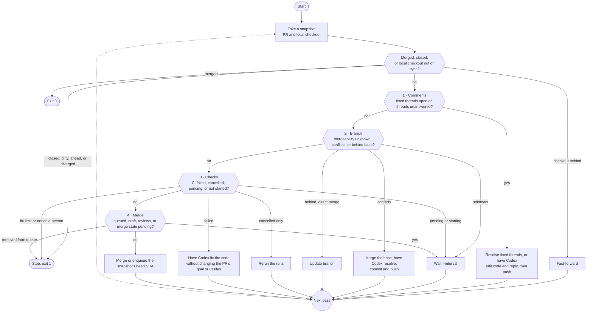

# baby-sitter

`baby-sitter` drives one GitHub pull request to merged. The binary does all routine work and every git and GitHub write. It calls Codex only to edit code and draft replies to review comments.

Visual version of the flow: [`design.html`](design.html).

## Requirements

- `gh` 2.97.0 or later, authenticated as the account that replies and merges. Job logs use `gh api --allow-escape-sequences`.
- `git`, with the PR's head branch checked out and tracking its remote branch.
- `codex`, logged in.

## Build

```sh
cargo install --path .
```

## Desktop app

`Baby Sitter.app` is a macOS window that runs the same binary for you, one process per PR. You don't need a terminal per PR.

Use the Settings gear on the pull requests page to manage repositories, or Refresh to reload the lists. From Repositories, use the back link to return to pull requests, or press Escape on either settings page.

For a draft pull request, use its Ready for review button to mark it ready on GitHub.

```sh
app/bundle.sh                       # builds target/release/Baby Sitter.app
open "target/release/Baby Sitter.app"
```

Drag the app to `/Applications` to keep it. The script needs Xcode's command line tools for `iconutil` and `codesign`. The bundle holds both binaries, the Dock name, and the icon rendered from `app/assets/icon.svg`.

For development, `cargo build --workspace && target/debug/baby-sitter-app` runs the window without a bundle. Both binaries must sit in the same directory. Outside the bundle the Dock shows the name `baby-sitter-app`, and system notification responses are disabled.

- **Repositories** groups accessible repositories by organization and leaves out archived ones. Filter by organization or watched status. Each filter button shows how many repositories it lists for the selected organization, and shows no number when that is zero. Use the toggle to watch a repository and the gear to set its timeout, draft timeout, and interval. A babysit started on a draft uses the draft timeout, and keeps that deadline if the PR is marked ready while it runs. The default interval is `30s`, not the CLI's `10s`. Each pass makes two GraphQL calls, so six PRs at `10s` use most of the hourly limit of 5,000 points.
- **Pull requests** lists your open PRs and completed babysits. Filter by repository or select All, Watched, Unwatched, or Merged; the Drafts only switch narrows the list to draft PRs. Each status button shows how many PRs it lists in a pill, and shows no pill when that is zero. Watched shows PRs with an active babysit. Unwatched shows PRs that are neither being babysat nor merged, including stopped, timed-out, cancelled, and failed babysits. Completed babysits keep their outcome and title across restarts until you dismiss them. Dismiss frees the PR at once: its worktree moves to a trash folder that is deleted in the background, and its local `baby-sitter/pr-<n>` branch is deleted, whatever the outcome. A merged babysit does the same as soon as the binary reports the merge.

  Each row starts with the PR's GitHub state before its title, as a GitHub icon and label: Ready, Draft, In queue, Merged, or Closed. The play or stop button left of the title starts or cancels a babysit. On the right, the GitHub button opens the PR, Dismiss appears for finished babysits, and the More actions menu marks a draft ready for review, converts a PR to draft, closes it after a confirmation, or copies its link. Clicking the repository and number under the title also copies the link. A running babysit shows its time left under these buttons.

  Each row shows what the latest pass is doing, and after a stop it shows the reason. Before that text, four icons show the four phases in order: comments, branch, checks, and merge. A draft shows only the first three. Green is done, amber is the phase in progress, red is blocked, and grey is a phase that has not started because an earlier one is not done; hover over an icon for its name. A badge in the same colors ends the line: a check for merged, a dash while the babysit runs or after a timeout, a cross after a stop or failure, and an empty ring after a cancel. Hover over the badge for the state's name, such as Stopped or Timed out. The app runs the binary with `--gates` to get the icons. After a stop, the row names the PR's worktree folder; the folder button reveals it in Finder.
- A notification from Baby Sitter appears when a babysit merges, times out, or stops, including while the app is in front. macOS asks for permission the first time. A cancel does not notify.

The app keeps its configuration, one clone per repository, and one worktree per PR in `~/Library/Application Support/baby-sitter`. It removes a worktree after a merge and deletes leftover worktrees for merged PRs when the PR list loads. After any other outcome it keeps the worktree and shows its path with a Reveal button.

Cancel sends SIGTERM to the run's process group and waits up to 10 seconds for every process to exit before it sends SIGKILL. Quitting the app stops every babysit, and the next launch restarts them with their original deadlines. Babysits you cancelled or that finished are not restarted.

The app refuses PRs from forks.

## Usage

Run the binary from the PR's checkout. Without an argument, it uses the PR for the current branch.

```sh
gh pr checkout 123
baby-sitter --dry-run    # print every rule's verdict, change nothing
baby-sitter              # drive the PR to merged
baby-sitter 123 --merge-method rebase --timeout 4h --interval 30s
```

| Flag | Default | Meaning |
|---|---|---|
| `--dry-run` | off | Print the verdict of every rule for the current snapshot, then exit. |
| `--merge-method` | `squash` | `squash`, `merge`, or `rebase` for direct merges. Merge queues use their configured method. |
| `--timeout` | `2h` | Deadline for the whole run, including every `gh`, `git`, and `codex` call. |
| `--interval` | `10s` | Time between snapshots while the run waits. |
| `--gates` | off | Before every decision, print each phase's state: `[gates] reviews=met checks=waiting branch=met merge=pending`. `reviews` is the Comments phase. A phase is `met` when it is complete, `waiting` while one of its rules waits or acts, and `blocked` when one stops the run. Every phase after the first incomplete one is `pending`. Merge is `waiting` while the binary merges or the PR sits in a queue, and `skipped` while the PR is a draft. |

| Exit code | Meaning |
|---|---|
| 0 | The PR is merged. A dry run exits 0 unless its first verdict is a stop. |
| 1 | The run stopped. The last line gives the reason. |
| 2 | The deadline passed. |

## Flow

Each pass takes a fresh snapshot of the PR. For an open PR, it also observes the local checkout. If a snapshot request to GitHub fails, the pass waits and tries again, and the run stops only after three failures in a row. Error messages lead with the cause, followed by a short command label such as `gh api graphql`.

A PR moves through four phases in a fixed order: Comments, Branch, Checks, and Merge. A phase starts only when every earlier phase is complete. Every pass checks the phases again from the top, so the run always works on the earliest phase that needs work. When an earlier phase stops being complete, for example a new review comment while the PR waits in a merge queue, or a base branch that moves while CI runs, every later phase goes back to pending and the run returns to the earlier phase. The four icons in the app and the `[gates]` line show this: done phases are green, the current phase is amber or red, and later phases are grey.



The rules live in `RULES` in `src/decide.rs`, grouped as preconditions and then the four phases. Within the table, order is precedence: the first rule that matches decides the pass. A direct merge or enqueue action runs only when no rule matches.

| Stage | Rules | Result when a rule matches |
|---|---|---|
| Preconditions | `merged`, `closed`, `local-upstream`, `local-dirty`, `local-diverged`, `local-behind` | Exit 0 for `merged`. Fast-forward a checkout that is behind. Stop for the others. |
| 1 · Comments | `resolve-fixed`, `unhandled-items` | Resolve threads whose newest marker says `fixed`. Send unanswered threads to Codex, push, reply in the threads, and request re-review. |
| 2 · Branch | `mergeability-unknown`, `conflict`, `behind-base` | Wait while GitHub computes mergeability. Merge the base and have Codex resolve conflicts, stopping after three resolve commits. Run `gh pr update-branch` for direct merges; a merge queue updates the branch itself. |
| 3 · Checks | `ci-failed`, `rerun-cancelled`, `fix-ci`, `ci-pending`, `ci-starting` | Wait for pending checks before fixing. Rerun Actions runs when every failure is a cancellation, stopping after a run's third attempt. Otherwise send failed job logs and external check URLs to Codex, then commit and push a code fix. Stop after three failed CI fixes. `ci-starting` waits when a head under three minutes old shows no checks yet, and a check suite that has not finished counts as pending CI. |
| 4 · Merge | `in-queue`, `dequeued`, `merge-state`, `unresolved-threads`, `review-requests`, `review-decision`, `draft` | Wait while queued, while reviews or the merge state block the merge, or while the PR is a draft. Stop if the current head was removed from the queue for a reason other than `merged`. |

CI fix commits carry the `Baby-Sitter: fix-ci` trailer. The binary stops if CI still fails after three fix commits among the PR's last 20 commits. Codex keeps the PR's purpose: it fixes what breaks the checks without reverting or reshaping the behavior the PR introduces, and returns `needs_human` when the only fix would contradict the PR's goal. It must not edit CI configuration or weaken tests. It fixes every cause that is in the code; when another cause needs a person, the binary pushes the code fix, waits for CI on it, and stops with the remaining reason once nothing code-side is left. The binary checks for protected CI configuration changes in the working tree before committing and in the commit before pushing. It leaves unsafe changes uncommitted or the unsafe commit local for inspection.

## Merge conflicts

A PR that conflicts with its base branch gets the same treatment as failing CI: the binary delegates the fix to Codex and stops only when a person is needed. The `conflict` rule runs after the local checkout checks, so it always works on a clean checkout that matches the PR head.

1. The binary fetches the base branch and runs `git merge --no-commit origin/<base>` in the checkout. It merges rather than rebases, so the push is a plain fast-forward and review comments stay attached to their commits. This matches `gh pr update-branch`.
2. If any conflicted file is CI configuration, it aborts the merge and stops. Those files follow the same rule as CI fixes: a person edits them.
3. Codex gets the list of conflicted files. It edits only those files, keeps the intent of both sides, and removes every conflict marker. It returns `resolved`, or `needs_human` when the conflict needs a product decision.
4. The binary checks Codex's work before committing. Only conflicted files may change, none of them may be CI configuration, and no conflict markers may remain. Any failure, and any `needs_human`, aborts the merge and stops with the reason, so the checkout never stays mid-merge.
5. It commits the merge with the `Baby-Sitter: resolve-conflicts` trailer and pushes. The next pass waits for CI on the new head.

The binary stops if the PR still conflicts after three resolve commits among its last 20 commits. A resolve commit that was made but not pushed is pushed on the next pass, like other baby-sitter commits.

## Checking Codex's edits

Before every Codex call (review threads, CI fixes, and merge conflicts), the binary installs the checkout's JavaScript dependencies so Codex can typecheck and test what it changes. It reads the lockfile at the checkout root: `pnpm-lock.yaml` runs `pnpm install --frozen-lockfile --prefer-offline`, `package-lock.json` runs `npm ci`, and `yarn.lock` runs `yarn install --frozen-lockfile`. The binary runs the install itself, outside Codex's sandbox, and skips it when the lockfile is unchanged since the last install in that checkout. Codex keeps no network access and may not install packages.

Codex is told to run the narrowest type checks, linters, and tests that cover the files it changed, and to fix what they report before it answers. When the install fails, Codex is told that checks are unavailable and must say so in its summary. Installs run the repository's install scripts with your permissions, as a local install does.

The desktop app gives the binary, Codex, and the package managers the PATH from your login shell, so version-managed tools such as `nvm` work when the app is opened from Finder.

## Review threads and replies

The binary handles unresolved review threads from people and bots. It replies only in those threads and never posts a top-level PR comment.

Codex gets every unanswered review thread in one batch. It edits files only and returns one result for each thread: `fixed`, `declined`, or `needs_human`, with reply text. If Codex fails, times out, or returns a result that does not match the batch, the run stops before it writes anything.

Every reply ends with a hidden marker:

```html
<!-- baby-sitter:v1 item=thread:PRRT_abc outcome=fixed answers=4628647074 -->
```

`answers` is the ID of the newest comment that Codex saw. A thread is unanswered when it has a comment from someone else that is newer than every comment you answered. The binary reads markers only from your own comments. A plain reply that you write by hand also answers the comments before it.

The binary resolves only `fixed` threads. Declined threads and threads that need a human stay open, and the merge waits until a person replies or resolves them.

## Restart after a crash

The binary keeps no local state file. Each pass reads progress from GitHub and from the checkout.

| The crash happened | The next run sees | The next run does |
|---|---|---|
| While Codex ran | A dirty tree, or the same unanswered items | Stops so you can inspect the tree, or calls Codex again |
| After the commit, before the push | The local branch is ahead | Pushes the commits if baby-sitter made all of them and none touches CI configuration. Stops if any commit is yours |
| After some replies | Markers on the answered items | Sends only the remaining items to Codex |
| Before the threads were resolved | Open threads with a `fixed` marker | Resolves them |
| Before the re-review request | Nothing | Nothing. The request is lost, and the merge still waits on the review decision. |

A lock file at `$(git rev-parse --git-dir)/baby-sitter/pr-<n>.lock` stops a second run on the same PR.

## Merge gate

The binary merges only when all of these are true:

- CI passed or the PR has no checks.
- `mergeStateStatus` is `CLEAN` or `HAS_HOOKS`, or `BEHIND` when the base uses a merge queue.
- No review threads are unresolved.
- No review requests are pending, unless GitHub already reports the PR approved. A re-review request the binary sent after fixing threads does not hold back an approved PR.
- `reviewDecision` is not `CHANGES_REQUESTED` or `REVIEW_REQUIRED`.

The merge passes `--match-head-commit` with the SHA from the snapshot. If someone pushes in between, GitHub rejects the merge and the run stops.

For a merge queue, the binary enqueues the snapshot's head SHA and uses the queue's configured merge method. It waits without handling new review feedback while the PR is queued because pushing would remove it from the queue. If the queue removes the current head without merging it, the run stops with the removal reason. A new head can be enqueued after the cause is fixed.

## Known limits

- The binary does not fix merge conflicts or non-code CI failures. It stops and names the cause.
- A PR with more than 100 review threads, comments in a thread, reviews, or review requests stops the run. The binary does not act on a partial view.
- A lost re-review request is not retried.
