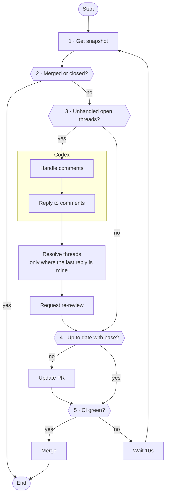

# baby-sitter

Babysits a pull request until it merges. A script runs the loop and does all the routine work. Codex is called only for judgment work: handling and replying to review comments.

Visual version: [`design.html`](design.html).

## Flow

| Step | Owner |
|---|---|
| Get snapshot | Script |
| Merged or closed? | Script |
| Find unhandled threads (tracks the PR's comment count so already-seen top-level comments aren't re-checked) | Script |
| Handle comments | Codex |
| Reply to comments | Codex |
| Resolve threads where the last reply is mine | Script |
| Request re-review | Script |
| Update PR with base | Script |
| Merge when CI is green, otherwise wait 10s and loop | Script |

## Open questions

1. **CI red vs. CI pending.** Both currently lead to "wait 10s", so a real failure loops forever.
2. **Merge conflicts** when updating the PR have no path yet.
3. **Merge gate.** CI green alone triggers the merge, even if a re-review is pending or a thread is open.
4. **Comment count vs. comment IDs.** Edits and deletions break count-based tracking.
5. **Codex replies post as me.** Codex replies are authored by my account, so a thread it couldn't fix passes the "last reply is mine" check and gets resolved.
6. **Stopping condition.** No limit on loops or wait time.
