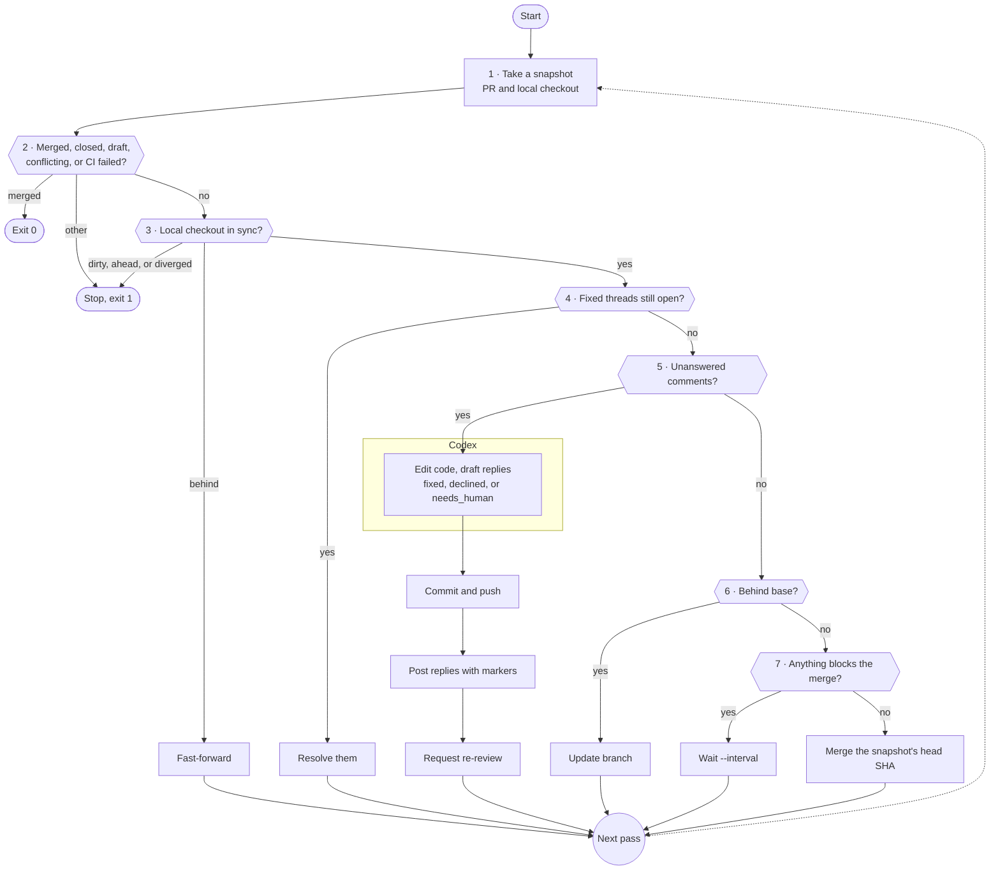

# baby-sitter

`baby-sitter` drives one GitHub pull request to merged. The binary does all routine work and every git and GitHub write. It calls Codex only to edit code and draft replies to review comments.

Visual version of the flow: [`design.html`](design.html).

## Requirements

- `gh`, authenticated as the account that replies and merges.
- `git`, with the PR's head branch checked out and tracking its remote branch.
- `codex`, logged in.

## Build

```sh
cargo install --path .
```

## Usage

Run the binary from the PR's checkout. Without an argument, it uses the PR for the current branch.

```sh
gh pr checkout 123
baby-sitter --dry-run    # print every rule's verdict, change nothing
baby-sitter              # drive the PR to merged
baby-sitter 123 --merge-method rebase --timeout 4h --interval 30s
```

| Flag | Default | Meaning |
|---|---|---|
| `--dry-run` | off | Print the verdict of every rule for the current snapshot, then exit. |
| `--merge-method` | `squash` | `squash`, `merge`, or `rebase`. |
| `--timeout` | `2h` | Deadline for the whole run, including every `gh`, `git`, and `codex` call. |
| `--interval` | `10s` | Time between snapshots while the run waits. |

| Exit code | Meaning |
|---|---|
| 0 | The PR is merged. A dry run exits 0 unless its first verdict is a stop. |
| 1 | The run stopped. The last line gives the reason. |
| 2 | The deadline passed. |

## Flow

Each pass takes a fresh snapshot of the PR and the local checkout. The first rule that matches decides the pass. After any action, the next pass takes a new snapshot, so no step acts on stale data.



The rules live in one ordered table, `RULES` in `src/decide.rs`. The table order is the precedence. Merge is not a rule. It runs only when no rule matches.

| Step | Rules | Result when a rule matches |
|---|---|---|
| 2 | `merged`, `closed`, `draft`, `conflict`, `ci-failed` | Exit 0 for `merged`. Stop for the others. |
| 3 | `local-upstream`, `local-dirty`, `local-diverged`, `local-behind` | Fast-forward when behind. Stop for the others. |
| 4 | `resolve-fixed` | Resolve threads whose newest marker says `fixed`. |
| 5 | `unhandled-items` | Send the items to Codex, push, reply, and request re-review. |
| 6 | `behind-base` | Run `gh pr update-branch`. |
| 7 | `ci-pending`, `merge-state`, `unresolved-threads`, `review-requests`, `review-decision` | Wait, then take a new snapshot. |

## Comments and replies

The binary handles three kinds of items:

- Unresolved review threads from people and bots.
- Top-level PR comments from people.
- Non-empty review bodies from people.

Codex gets every unanswered item in one batch. It edits files only and returns one result for each item: `fixed`, `declined`, or `needs_human`, with reply text. If Codex fails, times out, or returns a result that does not match the batch, the run stops before it writes anything.

Every reply ends with a hidden marker:

```html
<!-- baby-sitter:v1 item=thread:PRRT_abc outcome=fixed answers=4628647074 -->
```

`answers` is the ID of the newest comment that Codex saw. A thread is unanswered when it has a comment from someone else that is newer than every comment you answered. The binary reads markers only from your own comments. A plain reply that you write by hand also answers the comments before it.

The binary resolves only `fixed` threads. Declined threads and threads that need a human stay open, and the merge waits until a person replies or resolves them.

## Restart after a crash

The binary keeps no local state file. Each pass reads progress from GitHub and from the checkout.

| The crash happened | The next run sees | The next run does |
|---|---|---|
| While Codex ran | A dirty tree, or the same unanswered items | Stops so you can inspect the tree, or calls Codex again |
| After the commit, before the push | The local branch is ahead | Stops and tells you to push or reset |
| After some replies | Markers on the answered items | Sends only the remaining items to Codex |
| Before the threads were resolved | Open threads with a `fixed` marker | Resolves them |
| Before the re-review request | Nothing | Nothing. The request is lost, and the merge still waits on the review decision. |

A lock file at `$(git rev-parse --git-dir)/baby-sitter/pr-<n>.lock` stops a second run on the same PR.

## Merge gate

The binary merges only when all of these are true:

- CI passed or the PR has no checks.
- `mergeStateStatus` is `CLEAN` or `HAS_HOOKS`.
- No review threads are unresolved.
- No review requests are pending.
- `reviewDecision` is not `CHANGES_REQUESTED` or `REVIEW_REQUIRED`.

The merge passes `--match-head-commit` with the SHA from the snapshot. If someone pushes in between, GitHub rejects the merge and the run stops.

## Known limits

- The binary does not fix failing CI or merge conflicts. It stops and names the cause.
- A PR with more than 100 review threads, top-level comments, reviews, or review requests stops the run. The binary does not act on a partial view.
- Merge queues are not supported. After `gh pr merge` adds the PR to a queue, the PR stays open.
- A lost re-review request is not retried.
