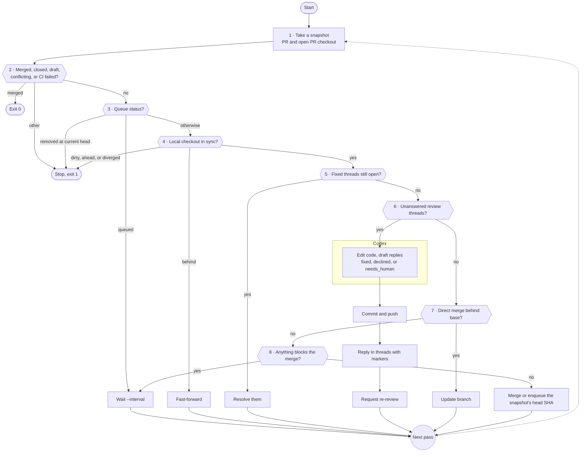

# baby-sitter

`baby-sitter` drives one GitHub pull request to merged. The binary does all routine work and every git and GitHub write. It calls Codex only to edit code and draft replies to review comments.

Visual version of the flow: [`design.html`](design.html).

## Requirements

- `gh`, authenticated as the account that replies and merges.
- `git`, with the PR's head branch checked out and tracking its remote branch.
- `codex`, logged in.

## Build

```sh
cargo install --path .
```

## Desktop app

`Baby Sitter.app` is a macOS window that runs the same binary for you, one process per PR. You don't need a terminal per PR.

```sh
app/bundle.sh                       # builds target/release/Baby Sitter.app
open "target/release/Baby Sitter.app"
```

Drag the app to `/Applications` to keep it. The script needs Xcode's command line tools for `iconutil` and `codesign`. The bundle holds both binaries, the Dock name, and the icon rendered from `app/assets/icon.svg`.

For development, `cargo build --workspace && target/debug/baby-sitter-app` runs the window without a bundle. Both binaries must sit in the same directory. Outside the bundle the Dock shows the name `baby-sitter-app`, and system notification responses are disabled.

- **Repositories** groups accessible repositories by organization and leaves out archived ones. Filter by organization or watched status, or search by name. Use the toggle to watch a repository and the gear to set its timeout and interval. The default interval is `30s`, not the CLI's `10s`. Each pass makes two GraphQL calls, so six PRs at `10s` use most of the hourly limit of 5,000 points.
- **Pull requests** lists your open PRs in the repositories you watch. Filter by repository, then press the play button to start a babysit or the stop button to cancel it. The GitHub button opens the PR. Each row shows what the latest pass is doing, and after a stop it shows the reason. Before that text, four icons show what the merge still needs: reviews, checks, an up-to-date branch, and the merge itself. Green is done, amber is waiting, red is blocked, and grey is not started; hover over an icon for its name. A badge in the same colors ends the line: a check for merged, a dash while the babysit runs or after a timeout, a cross after a stop or failure, and an empty ring after a cancel. Hover over the badge for the state's name, such as Stopped or Timed out. The app runs the binary with `--gates` to get the icons. After a stop, the row names the PR's worktree folder; the folder button reveals it in Finder.
- A notification appears when a babysit merges, times out, or stops. A cancel does not notify.

The app keeps its configuration, one clone per repository, and one worktree per PR in `~/Library/Application Support/baby-sitter`. It removes a worktree after a merge. After any other outcome it keeps the worktree and shows its path with a Reveal button.

Cancel sends SIGTERM to the run's process group and waits up to 10 seconds for every process to exit before it sends SIGKILL. Quitting the app stops every babysit, and the next launch restarts them with their original deadlines. Babysits you cancelled or that finished are not restarted.

The app refuses PRs from forks.

## Usage

Run the binary from the PR's checkout. Without an argument, it uses the PR for the current branch.

```sh
gh pr checkout 123
baby-sitter --dry-run    # print every rule's verdict, change nothing
baby-sitter              # drive the PR to merged
baby-sitter 123 --merge-method rebase --timeout 4h --interval 30s
```

| Flag | Default | Meaning |
|---|---|---|
| `--dry-run` | off | Print the verdict of every rule for the current snapshot, then exit. |
| `--merge-method` | `squash` | `squash`, `merge`, or `rebase` for direct merges. Merge queues use their configured method. |
| `--timeout` | `2h` | Deadline for the whole run, including every `gh`, `git`, and `codex` call. |
| `--interval` | `10s` | Time between snapshots while the run waits. |
| `--gates` | off | Before every decision, print each merge gate's state: `[gates] reviews=met checks=waiting branch=met merge=pending`. Each rule in `RULES` belongs to one gate. A gate is `blocked` when one of its rules stops the run, `waiting` when one waits or acts, and `met` otherwise. Merge is `pending` until the other three are met, then `waiting` while the binary merges or the PR sits in a queue. |

| Exit code | Meaning |
|---|---|
| 0 | The PR is merged. A dry run exits 0 unless its first verdict is a stop. |
| 1 | The run stopped. The last line gives the reason. |
| 2 | The deadline passed. |

## Flow

Each pass takes a fresh snapshot of the PR. For an open PR, it also observes the local checkout. The first rule that matches decides the pass. After any action, the next pass takes a new snapshot, so no step acts on stale data.



The rules live in one ordered table, `RULES` in `src/decide.rs`. The table order is the precedence. A direct merge or enqueue action runs only when no rule matches.

| Step | Rules | Result when a rule matches |
|---|---|---|
| 2 | `merged`, `closed`, `draft`, `conflict`, `ci-failed` | Exit 0 for `merged`. Stop for the others. |
| 3 | `in-queue`, `dequeued` | Wait while queued. Stop if the current head was removed for a reason other than `merged`. |
| 4 | `local-upstream`, `local-dirty`, `local-diverged`, `local-behind` | Fast-forward when behind. Stop for the others. |
| 5 | `resolve-fixed` | Resolve threads whose newest marker says `fixed`. |
| 6 | `unhandled-items` | Send unanswered threads to Codex, push, reply in the threads, and request re-review. |
| 7 | `behind-base` | Run `gh pr update-branch` for direct merges. Skip this rule for merge queues. |
| 8 | `ci-pending`, `merge-state`, `unresolved-threads`, `review-requests`, `review-decision` | Wait, then take a new snapshot. |

## Review threads and replies

The binary handles unresolved review threads from people and bots. It replies only in those threads and never posts a top-level PR comment.

Codex gets every unanswered review thread in one batch. It edits files only and returns one result for each thread: `fixed`, `declined`, or `needs_human`, with reply text. If Codex fails, times out, or returns a result that does not match the batch, the run stops before it writes anything.

Every reply ends with a hidden marker:

```html
<!-- baby-sitter:v1 item=thread:PRRT_abc outcome=fixed answers=4628647074 -->
```

`answers` is the ID of the newest comment that Codex saw. A thread is unanswered when it has a comment from someone else that is newer than every comment you answered. The binary reads markers only from your own comments. A plain reply that you write by hand also answers the comments before it.

The binary resolves only `fixed` threads. Declined threads and threads that need a human stay open, and the merge waits until a person replies or resolves them.

## Restart after a crash

The binary keeps no local state file. Each pass reads progress from GitHub and from the checkout.

| The crash happened | The next run sees | The next run does |
|---|---|---|
| While Codex ran | A dirty tree, or the same unanswered items | Stops so you can inspect the tree, or calls Codex again |
| After the commit, before the push | The local branch is ahead | Stops and tells you to push or reset |
| After some replies | Markers on the answered items | Sends only the remaining items to Codex |
| Before the threads were resolved | Open threads with a `fixed` marker | Resolves them |
| Before the re-review request | Nothing | Nothing. The request is lost, and the merge still waits on the review decision. |

A lock file at `$(git rev-parse --git-dir)/baby-sitter/pr-<n>.lock` stops a second run on the same PR.

## Merge gate

The binary merges only when all of these are true:

- CI passed or the PR has no checks.
- `mergeStateStatus` is `CLEAN` or `HAS_HOOKS`, or `BEHIND` when the base uses a merge queue.
- No review threads are unresolved.
- No review requests are pending.
- `reviewDecision` is not `CHANGES_REQUESTED` or `REVIEW_REQUIRED`.

The merge passes `--match-head-commit` with the SHA from the snapshot. If someone pushes in between, GitHub rejects the merge and the run stops.

For a merge queue, the binary enqueues the snapshot's head SHA and uses the queue's configured merge method. It waits without handling new review feedback while the PR is queued because pushing would remove it from the queue. If the queue removes the current head without merging it, the run stops with the removal reason. A new head can be enqueued after the cause is fixed.

## Known limits

- The binary does not fix failing CI or merge conflicts. It stops and names the cause.
- A PR with more than 100 review threads, comments in a thread, reviews, or review requests stops the run. The binary does not act on a partial view.
- A lost re-review request is not retried.
