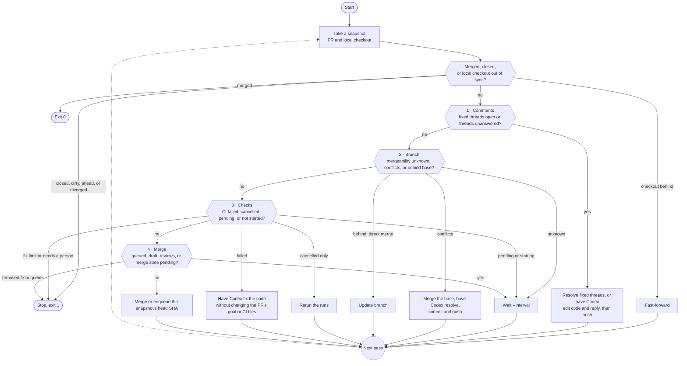

# How baby-sitter works

This page is the reference for what `baby-sitter` decides on each pass and why. For installation and everyday use, see the [README](../README.md). [`design.html`](../design.html) draws the same flow.

## Each pass starts from a fresh snapshot

Each pass reads the PR from GitHub and, for an open PR, inspects the local checkout. The binary keeps no state file. Everything it knows comes from GitHub and the checkout, so a crashed run can restart from the same place.

If a snapshot request to GitHub fails, the pass waits and tries again. The run stops only after three failures in a row. Error messages put the cause first, followed by a short label for the command, such as `gh api graphql`.

## A PR moves through four phases in order

The phases are Comments, Branch, Checks, and Merge. A phase starts only when every earlier phase is complete. Every pass checks the phases again from the top, so the run always works on the earliest phase that needs work.

When an earlier phase stops being complete, every later phase goes back to pending and the run returns to the earlier phase. A new review comment while the PR waits in a merge queue sends the run back to Comments. A base branch that moves while CI runs sends it back to Branch. The `--gates` line and the four icons in the app show this state: done phases are green, the current phase is amber or red, and later phases are grey.



## Rules decide each pass

The rules live in `RULES` in `src/decide.rs`, grouped as preconditions and then the four phases. Order is precedence. The first rule that matches decides the pass. The binary merges or enqueues only when no rule matches.

| Stage | Rules | Result when a rule matches |
|---|---|---|
| Preconditions | `merged`, `closed`, `local-upstream`, `local-dirty`, `local-diverged`, `local-behind` | Exit 0 for `merged`. Fast-forward a checkout that is behind. Stop for the others. |
| 1 · Comments | `resolve-fixed`, `unhandled-items` | Resolve threads whose newest marker says `fixed`. Send unanswered threads to Codex, push, reply in the threads, and request re-review. |
| 2 · Branch | `mergeability-unknown`, `conflict`, `behind-base` | Wait while GitHub computes mergeability. Merge the base and have Codex resolve conflicts. Run `gh pr update-branch` for direct merges. A merge queue updates the branch itself. |
| 3 · Checks | `ci-failed`, `rerun-cancelled`, `fix-ci`, `ci-pending`, `ci-starting` | Wait for pending checks before fixing. Rerun Actions runs when every failure is a cancellation. Otherwise send the failures to Codex, then commit and push a code fix. |
| 4 · Merge | `in-queue`, `dequeued`, `review-decision`, `review-requests`, `unresolved-threads`, `draft`, `merge-state` | Wait while queued, while reviews block the merge, or while the PR is a draft. The wait message names the reviewers who requested changes and the pending review requests. Stop if the queue removed the current head for a reason other than a merge. |

`--dry-run` prints every rule's verdict for the current snapshot.

## Review threads get replies in place

The binary handles unresolved review threads from people and bots. It replies only inside those threads and never posts a top-level PR comment.

Codex gets every unanswered thread in one batch. It edits files and returns one result for each thread: `fixed`, `declined`, or `needs_human`, with the reply text. If Codex fails, times out, or returns a result that does not match the batch, the run stops before it writes anything.

Every reply ends with a hidden marker:

```html
<!-- baby-sitter:v1 item=thread:PRRT_abc outcome=fixed answers=4628647074 -->
```

`answers` is the ID of the newest comment that Codex saw. A thread is unanswered when someone else commented after every comment you answered. The binary reads markers only from your own comments. A reply you write by hand also counts as an answer to the comments before it.

The binary resolves only `fixed` threads. Declined threads and threads that need a person stay open, and the merge waits until someone replies or resolves them.

## Merge conflicts are resolved by merging, not rebasing

A conflicting PR gets the same treatment as failing CI. The `conflict` rule runs only on a clean checkout that matches the PR head.

1. The binary fetches the base branch and runs `git merge --no-commit origin/<base>`. Merging keeps the push a plain fast-forward and keeps review comments attached to their commits, as `gh pr update-branch` does.
2. If any conflicted file is CI configuration, the binary aborts the merge and stops. A person edits those files.
3. Codex gets the list of conflicted files. It edits only those files, keeps the intent of both sides, and removes every conflict marker. It returns `resolved`, or `needs_human` when the conflict needs a product decision.
4. The binary checks the result. Only conflicted files may change, none may be CI configuration, and no conflict markers may remain. A failed check or a `needs_human` aborts the merge and stops with the reason, so the checkout never stays mid-merge.
5. The binary commits the merge with the `Baby-Sitter: resolve-conflicts` trailer and pushes.

The run stops if the PR still conflicts after three resolve commits among its last 20 commits.

## CI fixes keep the PR's purpose

Before fixing, the binary waits for pending checks, so Codex sees every failure at once. When every failure is a cancelled Actions run, the binary reruns it instead, up to a run's third attempt. Only the newest check suite for each workflow counts, so a superseded cancelled run does not trigger a fix.

Codex gets the failed Actions job logs and the URLs of failing external checks. It fixes every cause that is in the code, without reverting, disabling, or reshaping the behavior the PR introduces. It must not edit CI configuration or delete, skip, or weaken tests. When the only fix would contradict the PR's goal, or a cause needs a person, it returns `needs_human`. The binary still pushes any code fix, waits for CI on it, and stops with the remaining reason once nothing in the code is left to fix.

The binary checks for CI configuration changes in the working tree before committing and in the commit before pushing. It leaves an unsafe change uncommitted, or an unsafe commit local, for you to inspect. Fix commits carry the `Baby-Sitter: fix-ci` trailer, and the run stops if CI still fails after three fix commits among the PR's last 20 commits.

## Each Codex prompt has a fixed frame

Codex gets one of three prompts: `review` for unanswered threads, `ci` for failing checks, and `conflicts` for merge conflicts. Each prompt is built in four parts, in this order:

1. The instructions. `baby-sitter --print-default-prompts` prints the defaults. `--prompts <file>` or **Settings > Prompts** in the app replaces them.
2. The data: the `ITEM` blocks for review threads, the failing checks and their logs, or the base branch and the conflicted files.
3. A fixed rule that Codex must not run `git` or `gh` and must not install packages. Custom instructions cannot remove it. It is an instruction to Codex, not a runtime block.
4. The note about installed dependencies described below.

The binary checks the `--prompts` file at startup and stops with the cause when the file is invalid. A missing file means the defaults. The binary reads the file again before each Codex call, so a running babysit picks up a change at its next call. The app always passes `<data dir>/prompts.json` and deletes the file when no custom prompt is saved and turned on.

Custom instructions cannot loosen what the code enforces. Codex must still reply in the JSON shape the binary expects. The binary still refuses to commit or push CI configuration changes, and it still checks conflict resolutions before it commits them.

## Codex can check its own edits

Before every Codex call, the binary installs the checkout's JavaScript dependencies so Codex can typecheck and test what it changes. The lockfile at the checkout root picks the command:

| Lockfile | Command |
|---|---|
| `pnpm-lock.yaml` | `pnpm install --frozen-lockfile --prefer-offline` |
| `package-lock.json` | `npm ci` |
| `yarn.lock` | `yarn install --frozen-lockfile` |

The binary runs the install itself, outside Codex's sandbox. It skips the install when the lockfile has not changed since the last install in that checkout. Codex runs with `--sandbox workspace-write`, has no network access, and may not install packages. It is told to run the narrowest type checks, linters, and tests that cover the files it changed. When the install fails, Codex is told that checks are unavailable and must say so. Installs run the repository's install scripts with your permissions, as a local install does.

## The merge waits for every gate

The binary merges only when all of these are true:

- CI passed, or the PR has no checks.
- `mergeStateStatus` is `CLEAN` or `HAS_HOOKS`, or `BEHIND` when the base uses a merge queue.
- No review threads are unresolved.
- No review requests are pending, unless GitHub already reports the PR approved.
- `reviewDecision` is not `CHANGES_REQUESTED` or `REVIEW_REQUIRED`.
- The PR is not a draft.

The merge passes `--match-head-commit` with the snapshot's SHA. If someone pushes in between, GitHub rejects the merge and the next pass starts over.

With a merge queue, the binary enqueues the snapshot's head SHA and the queue's merge method applies. While the PR is queued, the run keeps checking the earlier phases. Handling a new review comment pushes a commit, which removes the PR from the queue, and the new head is enqueued once the earlier phases are green again. If the queue removes the current head without merging it, the run stops with the queue's reason.

## A crashed run restarts where it left off

| The crash happened | The next run sees | The next run does |
|---|---|---|
| While Codex ran | A dirty tree, or the same unanswered items | Stops so you can inspect the tree, or calls Codex again |
| After the commit, before the push | The local branch is ahead | Pushes the commits if baby-sitter made all of them and none touches CI configuration. Stops if any commit is yours |
| After some replies | Markers on the answered items | Sends only the remaining items to Codex |
| Before the threads were resolved | Open threads with a `fixed` marker | Resolves them |
| Before the re-review request | Nothing | Nothing. The request is lost, and the merge still waits on the review decision |

A lock file at `$(git rev-parse --git-dir)/baby-sitter/pr-<n>.lock` stops a second run on the same PR.

## The app runs one process per PR

The app keeps its configuration, one clone per repository, and one worktree per PR in `~/Library/Application Support/baby-sitter`. It runs `baby-sitter --gates` in the PR's worktree and reads the phase icons and status from its output. Child processes get the `PATH` from your login shell, so version-managed tools such as `nvm` work when the app opens from Finder.

When a babysit starts, the app runs the repository's **Setup command**, if one is set and has not finished in that PR's worktree yet, as `/bin/sh -c "<command>"` in the worktree with the same `PATH`. It runs after the app releases the repository lock, so a long install does not hold up other babysits in the same repository. A stop or the deadline ends it like any other babysit step. After it succeeds, the app records the command under `setup/` in its data folder, outside the worktree, so later starts skip it until the command changes or the worktree is removed. A setup cut short by a quit or crash runs again on the next start. If it fails, the babysit stops with the command's last error line and the app removes the new worktree, so the next start creates the worktree and runs the setup again. The binary still installs JavaScript dependencies before each Codex call, as described above, and skips that install when the lockfile has not changed since its last install in that checkout.

Stopping a babysit sends `SIGTERM` to its process group and sends `SIGKILL` to whatever is still running 10 seconds later. Quitting the app stops every babysit, and the next launch restarts them with their original deadlines.

After a merge, the app removes the worktree. After any other outcome, it keeps the worktree until you dismiss the row. Dismiss moves the worktree into a trash folder at once and deletes it in the background, so a large `node_modules` never blocks a restart. The app clears leftover trash at launch.

**Settings > Status** runs these checks at launch, when you select **Check again**, and when the window comes back to the front while the page is open, with the same `PATH` babysits use. Each command has a 10-second limit. While the page is open, the notifications check also repeats every second, because macOS does not announce changes to notification settings. Turning notifications on or off in System Settings updates the row within a second.

| Check | Required | Passes when |
|---|---|---|
| GitHub CLI | yes | `gh --version` reports 2.97.0 or later |
| GitHub sign-in | yes | `gh auth status --hostname github.com` names an account, and the token scopes, when listed, include `repo` |
| Git | yes | `git --version` runs |
| Codex CLI | yes | `codex --version` runs |
| Codex sign-in | yes | `codex login status` exits 0 |

The **Permissions** section reads Baby Sitter's notification settings from macOS. It is green when notifications are allowed with banners and Notification Center on. When macOS has not asked yet, **Allow notifications** shows the prompt. When notifications are off, or allowed but hidden from banners or Notification Center, **Open System Settings** opens Baby Sitter's notification settings. A permission problem does not raise the banner on the Pull requests page, because babysits run without notifications.

Baby Sitter needs no other macOS permission. It writes only under `~/Library/Application Support/baby-sitter`. A prompt for Desktop, Documents, or Photos during a babysit comes from Codex reading outside the checkout. Choose **Don't Allow**.
